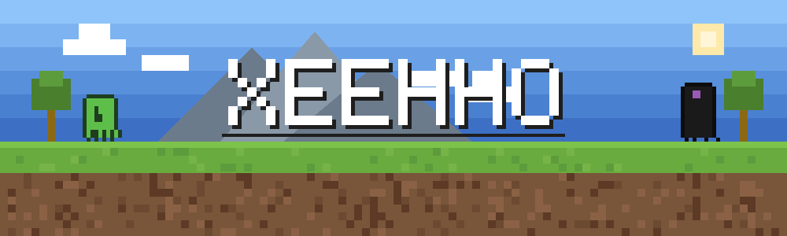

  
  
  
  

### 你好，我是 Xeehho 👋

**独立游戏开发 · 跨端前端 · AI 应用工程**

我用 **Godot** 做游戏和地图工具，用 **React / Taro / TypeScript** 构建跨端应用，也用 **Python** 探索 AI 工作流、本地模型与量化研究。从玩法设计、程序开发到素材管线，喜欢亲手把想法做成可以运行、可以验证的东西。

最近的项目围绕三个方向展开：**大唐题材游戏与像素地图制作、AI 辅助开发、个人研究工具**。也参与 DSH Web / Desktop 生态的开源修复。

项目近况整理于 2026-10-27；下文区分已实现内容、开发分支与后续计划。

### 游戏与地图工具 / Games & Tools

#### [KufuWorld](https://github.com/Xeehho/kufuworld) · Godot 2D RPG

从「江湖志」武侠探索原型继续向**大唐题材 RPG**重构，探索城市场景、经营养成与声望驱动的玩法。

- **已有基础**：气候驱动的程序化世界、城镇与门派、NPC 日程、架势战斗、任务奇遇、农耕建造；小地图和基础音效已接入。
- **近期推进**：长安城独立预览、天香阁院落与室内场景、原生素材拼装，以及 Tiled 地形与道路自动拼接工具链；玩法线上继续推进声望 / 天命系统与剧情任务桥接。
- **当前阶段**：场景与玩法重构中，相关工作仍在开发分支及本地原型迭代，尚未完整同步到公开默认分支。完整主线、内容整合与正式版本仍在制作。

#### [TileMason](https://github.com/Xeehho/tilemason) · 2D 像素地图拼装桌面工具

把游戏里的地图制作需求做成独立工具：像创造模式一样，用素材件搭街道、建筑、庭院与室内，再导出 **Godot 场景 / 结构化 JSON**。

- **已实现**：画笔与区域编辑、道路 / 墙体自动连接、素材搜索与标签、预制件、批量替换、撤销重做、自动保存、地图检查与场景导出。
- **近期推进**：编辑器工作台、Dock 折叠、小窗口布局、素材选择联动与快捷栏体验。
- **当前阶段**：核心编辑流程已完成，首个正式 Release 待发布；目前可从源码体验。

#### 《大豪绅》 · 中国古代商路桌游原型 🔒

私有项目 `steam-monopoly-game`，使用 Godot 开发，计划面向 Steam。已跑通 **2–4 人、本地热座 / AI、地产经营、商股买卖与本地存档**的单局流程。

长安、金陵两张单城大棋盘已在开发分支实现：独立玩家棋子沿路行走，两侧地块可以买卖、收租并逐级建设，支持全城总览、平移缩放和镜头跟随。该地图重构目前仍为 **Draft PR，尚未合并**；美术、音频、平衡与发布流程继续打磨。

### 私人项目 / Private Projects

#### stock-backtest · 个人 A 股研究与半量化工具 🔒

把 AI 分析、行情工具、回测研究、风险纪律与人工交易反馈放进同一套工作流。重点在于**数据质量、可追溯的研究结果和明确的执行条件**。

- 已建设数据门禁、冻结快照回测、滚动样本外研究、成交账本、结构化动作校验与回归 / 独立验收工具。
- 正在完善指导与成交反馈的统一接线。既有流程由人确认并执行交易；新账本的生产接入与策略效果验证仍在推进。

#### llm-finetune · 本地模型部署与 QLoRA 微调实验 🔒

围绕 **Ollama / Qwen3-8B / QLoRA / GGUF** 搭建个人实验台。本地模型已接入 ZCode，仓库包含 Colab 训练笔记本、数据样例、导出脚本与基座 / 微调模型对比评估工具。

当前实验是「禅意助手」的语言风格微调，关注**风格一致性与事实保真**，继续验证训练、导出和本地使用的流程。

私有项目仅在这里介绍用途与技术方向，源码及个人数据不公开。

### 开源项目与贡献 / Open Source

| 项目 | 我的工作 |
| --- | --- |
| [react-free-editor](https://github.com/Xeehho/react-free-editor) | 基于 React / TypeScript / Tiptap 的富文本编辑器，支持所见即所得与 Markdown 双模式、媒体上传和自定义内容块。 |
| [dsh-web](https://github.com/zhu1090093659/dsh-web) | 参与皮肤中心与壁纸模块修复。已合并 PR：[缓存版本化 #793](https://github.com/zhu1090093659/dsh-web/pull/793)、[表面 token 回退 #784](https://github.com/zhu1090093659/dsh-web/pull/784)、[半透明面板 #789](https://github.com/zhu1090093659/dsh-web/pull/789)、[开机恢复壁纸 #622](https://github.com/zhu1090093659/dsh-web/pull/622)。 |
| [dsh-desktop](https://github.com/anywhere-labs/dsh-desktop) | 布局服务冲突降级：上游已注册服务时安全让位，避免插件回滚引发样式丢失；[修复提交已进入主分支](https://github.com/anywhere-labs/dsh-desktop/commit/2756dbc)。 |

### 技术栈 / Tech Stack

| 方向 | 常用技术 |
| --- | --- |
| 游戏与工具 | Godot 4 · GDScript · 像素素材管线 · Tiled · 程序化生成 |
| 前端 | TypeScript · JavaScript · React · Taro · HTML / CSS · Tiptap |
| AI 与研究 | Python · LangChain · LangGraph · Ollama · QLoRA · 回测与数据校验 |
| 工程实践 | Git · 自动化回归 · 独立验收 · 截图走查 · AI 辅助开发 |

  
  
  

